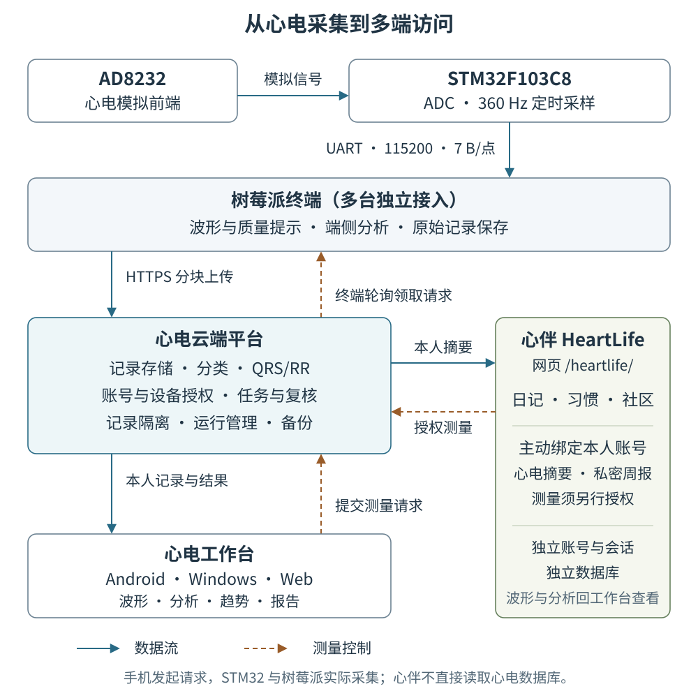
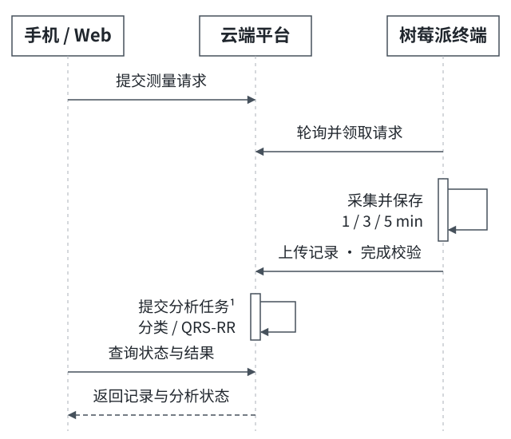

# 心电采集与分析系统

**STM32 采集 · 树莓派终端 · 云端平台 · 心电健康助手**

这是一个面向生物医学工程课程与实验研究的软硬件系统，把**心电采集、现场显示、本地保存、云端分析和多端回看**串成一条完整流程。用户完成一次测量后，可以在手机或电脑中找到自己的记录，回看波形、了解信号质量、查看分析结果并导出报告。

项目以**云端作为统一平台**：多台树莓派分别接入，记录与账号、设备关联；Android、Windows 和浏览器使用同一套平台账号访问。树莓派负责现场采集与保存，云端负责记录管理和后台分析，管理员负责账号、设备授权及维护。

[在线使用](#在线使用) · [系统总览](#系统总览) · [测量流程](#从测量到报告) · [算法与验证](#算法与验证) · [下载应用](#应用下载) · [开发入口](#开发环境)

## 在线使用

| 入口 | 用途 | 账号 |
| --- | --- | --- |
| [心电工作台](https://62.234.150.104/) | 记录、波形、趋势、测量请求与报告；管理员登录后进入管理后台 | 心电平台账号，可在登录页申请 |
| [心伴 HeartLife](https://62.234.150.104/heartlife/) | 健康日记、习惯、社区；授权后连接本人心电记录 | 独立心伴账号，需主动绑定心电账号 |

**服务已于 2026-11-27 上线统一版本 `6ac70ff3`**：心电云端、心伴后端和心伴生产前端使用同一源码提交，HTTPS、认证检查和数据备份校验通过。真实账号登录与绑定、实体设备测量与报告仍待验收。本次未更新 APK、Windows 启动器、树莓派程序或 STM32 固件；详细证据与待办见[版本与交付状态](docs/版本与交付状态.md)。

## 项目目标

- **把一次测量做完整：** 从身份确认、采集引导到定时结束、测后总结和上传，既能现场看，也能事后查。
- **让多设备、多用户共用平台：** 采集设备独立接入，用户只查看自己的记录，手机与电脑共用云端数据。
- **让分析有依据、结果可追溯：** 保留原始采样，将模型预测、QRS/RR 指标和人工复核分别记录，用公开数据实验评估算法表现。

## 系统总览



**实线表示数据流，虚线表示测量控制方向。** AD8232 心电前端连接 STM32，STM32 按 360 Hz 采样并输出七字节串口帧；树莓派接收、显示和保存，再通过网络上传。云端统一存储、分析和管理记录，手机与电脑负责查询、操作和展示结果。

**测量请求沿另一条路径返回终端。** 手机选择已授权设备并提交请求，树莓派轮询云端领取后执行；手机本身不采集心电。当前 STM32 到树莓派使用串口，STM32 通过蓝牙连接手机或直接无线入云属于[后续方案](#后续深化方向)。

**心伴通过授权接口连接心电平台。** 两端保留独立账号、会话和数据库；主动绑定后读取本人摘要与私密周报，另行授予测量权限后才可提交请求。波形、分类与 QRS/RR 详情仍在心电工作台查看。图示对应当前源码的服务关系，安装包和实机验收状态见[版本与交付状态](docs/版本与交付状态.md)。

现有硬件基础为 AD8232、STM32F103C8、Raspberry Pi 2 及显示设备。完整交互时序见[系统架构](docs/系统架构.md)，接线与引脚见[硬件资料](硬件/STM32心电采集/Doc/README.md)。

## 从测量到报告

下图以远程测量为例，展示工作台直接发起与心伴经授权发起两种入口；按时间从上向下阅读，入口二选一。固定时长测量需要云端、终端与应用版本配套。



图中 ¹：分析可由用户操作触发，或由已开启的自动分析设置触发；自动分析默认关闭。上传完成与分析完成分别判断，查询时可能仍在排队或处理中。

- **现场测量：** 在树莓派确认使用者和设备状态后开始，可手动结束或选择固定时长；暂停波形显示不等于停止采集。
- **手机发起：** 选择已授权且就绪的设备，提交 1 / 3 / 5 分钟请求；终端负责计时、采集、落盘与上传。这里的“定时”指固定时长，不是每日定点测量。
- **测后回看：** 本地总结来自终端统计；云端心搏分类与 QRS/RR 分别分析，任务状态可查询。上传后自动分析可按账号开启，默认关闭。
- **断网处理：** 已保存记录留在终端，恢复连接后可补传。上传成功与分析完成是两个状态，分析失败不会撤销原始上传。

最终得到的是一条可追溯的测量记录：**原始波形 + 实际采样时长 + 质量与终端摘要 + 云端分析结果 + 复核/标注 + 导出入口**。尚未计算或条件不足的指标应明确显示原因。

## 主要功能

心伴模块提供日记、习惯计划、社区与健康周报；绑定后可查看本人心电摘要与私密心电周报，另行授权后可发起 1 / 3 / 5 分钟测量并查看进度。入口、权限和配置见[心电集成指南](heartlife/docs/心电集成.md)。两个服务保留独立账号、数据库和会话。新安装默认关闭集成；本次服务器已完成集成配置，用户仍需分别登录、主动绑定和授权。

下表描述当前主分支已实现的能力；源码、公开安装包、服务器部署和实机验收分别记录，实际可用范围见[版本与交付状态](docs/版本与交付状态.md)。

| 组成 | 负责什么 | 用户能够得到什么 |
| --- | --- | --- |
| **STM32 采集端** | 定时 ADC 采样，输出来源、无效标记、序号和校验信息 | 有采样顺序与状态依据的原始心电数据 |
| **树莓派终端** | 串口接收、波形显示、信号质量提示、端侧分类、测量引导与本地保存 | 现场波形、心率/质量提示、固定时长测量和测后总结 |
| **云端平台** | 多设备接入、账号数据隔离、分块上传、持久分析任务、记录管理 | 可检索的历史记录，独立分类与 QRS/RR 结果，复核及片段标注 |
| **手机与电脑** | 使用同一平台账号查看记录、设备、趋势与任务 | 波形回看、日/月/年趋势、远程测量请求、CSV 与报告预览/打印 |
| **管理员后台** | 申请审核、账号生命周期、设备授权、运行概览、完整性检查和备份 | 集中维护账号、设备和记录元信息；手动备份及默认关闭的每日备份计划 |

**数据与权限：** 原始采样不被滤波或分析结果覆盖；普通用户仅访问本人记录。管理员可管理记录元信息，但不会因此获得他人的波形或模型结果。账号申请通过后，仍需单独取得设备授权。

**各端的区别：** Android 使用随 APK 安装的页面及原生保存/打印能力；Windows 启动器打开云端网页；浏览器/PWA 直接访问服务器页面，iPhone 可添加到主屏幕。因此，网页更新、APK 升级和终端升级是不同操作。

## 算法与验证

系统同时保留现场分析和上传后的云端分析，便于分别查看采集状态与回溯结果。它们使用同一条原始记录，但指标来源不同，不能混作一个结论。

| 分析内容 | 用途 | 需要怎样理解 |
| --- | --- | --- |
| **预处理与质量判断** | 为波形显示、心率和模型输入提供处理与质量依据 | 原始 ADC 单独保留；无效、断流或质量不足片段不能当作正常信号 |
| **QRS / RR** | 检测心搏位置 R 峰，统计相邻心搏间隔 RR 和换算心率 | 云端独立运行，跨断段不连接 RR；与终端摘要、历史趋势分开解释 |
| **N / S / V 心搏分类** | 当前固定 CardioEdgeAI 模型及专用 NumPy 适配器提供三类预测 | 属于模型标签，分数不是诊断概率；人工复核不改写原始数据或模型标签 |
| **HRV 条件判断** | 判断是否具备可信正常窦性间期（NN）用于心率变异性分析 | 当前没有可信 NN 时显示不可用，只保留 RR 变异性；预测为 N 类不等于可信 NN |

分类标签中，**N 是常见搏动组（包含束支阻滞），S 是室上性异位搏动，V 是室性异位搏动**。N 不表示完全健康，S/V 提示也需要结合波形复核。历史趋势心率来自终端质量合格窗口的统计，不取云端 QRS 结果。

**已有公开数据实验：** 在 MIT-BIH 44 条非起搏完整记录上，对比现有 QRS、XQRS 和 FastNVG；在 150 ms 匹配条件下，F1 分别为 **99.27%、99.21%、99.13%**。现有方法使用流式输入及质量门控，后两种使用整段离线输入，不能把排名直接当作可互换性或实机性能结论。

当前分类模型另在 21 条记录上独立评测，完整链路宏平均 F1 为 **66.44%**，其中 S 类 F1 为 **23.85%**，仍需重点改善与验证。该结果与 QRS 的检测 F1 衡量不同任务；本轮比较没有自动替换生产默认算法或模型。

实验条件、覆盖率、逐记录结果与复跑方法见[完整评测报告](docs/algorithm-validation/算法对比与分类评测.md)和[算法导航](docs/算法与评估.md)。软件测试及公开数据库回放已提供开发证据，真实采集、设备性能、长期稳定性和实体客户端验收需分别完成；本项目用于课程与研究，不提供临床诊断结论。

## 后续深化方向

- **基础链路验收：** 在 STM32、树莓派、实体手机和另一台电脑上完成采集、保存、补传、分析、导出及升级验证，并测量时延、内存与稳定性。
- **算法深化：** 分析 S 类识别与噪声问题，补充外部数据验证、可信 NN 判定及性能/量化对照。
- **无线扩展（尚未实现）：** 比较两条方案后选择原型路线，不把它们算入当前可用功能。

| 后续方案 | 设想链路 | 还需完成 |
| --- | --- | --- |
| 手机中转 | STM32 → 外接 BLE 模块 → Android → HTTPS → 云端 | 蓝牙协议、配对、缓存、断连恢复及手机后台验证 |
| 设备直连 | STM32 → 外接 Wi-Fi 模块 → HTTPS → 云端 | 配网、设备认证、TLS、存储、重传及稳定性验证 |

两条路线均需新增无线模块和配套程序；现有手机访问云端不代表已支持蓝牙采集。阶段目标和验收条件见[项目计划书](docs/项目计划书.md)。

## 应用下载

- **Android 8.0+**：[下载心电健康助手 1.1.0 APK](https://github.com/XiongBoT/bme-ecg-system/releases/download/android-v1.1.0-preview.1/ecg-records-1.1.0.apk) · [版本说明与校验](https://github.com/XiongBoT/bme-ecg-system/releases/tag/android-v1.1.0-preview.1)
- **Windows 10/11**：[下载心电工作台 1.2.0 ZIP](https://github.com/XiongBoT/bme-ecg-system/releases/download/desktop-v1.2.0/ecg-workspace-windows-1.2.0.zip) · [版本说明与校验](https://github.com/XiongBoT/bme-ecg-system/releases/tag/desktop-v1.2.0)
- **浏览器 / iPhone**：[打开云端工作台](https://62.234.150.104/)；iPhone 可添加到主屏幕。

Windows 完整解压后运行“心电工作台.exe”，无需安装 Python 或 Node.js。安装步骤见 [Windows 说明](心电云端平台/deploy/desktop/使用说明.txt)和[手机安装指南](docs/手机端与安卓安装包.md)。

> **版本说明：** Android 1.1.0 和 Windows 1.2.0 为公开试用版，构建自 `87f23ba`；服务器已部署 `6ac70ff3`。Windows 启动器打开当前服务器网页，Android 仍使用 APK 内置页面。固定时长测量还需配套终端及实体设备验收，详见[版本与交付状态](docs/版本与交付状态.md)。

当前公开 APK 不包含随后合入的片段标注、自动备份、导航调整和心伴连接入口。手机浏览器可访问当前网页；APK 内置界面需通过同签名安装包升级，刷新页面不会替换。

## 快速使用

1. **登录账号。** 打开[心电工作台](https://62.234.150.104/)，用本人平台账号登录；新用户点击“申请账号”，等待管理员审核。忘记密码时联系项目管理员。
2. **完成测量。** 管理员先为账号授权设备，再在树莓派终端选择本人账号，采集、保存并上传。配套升级完成后，也可从手机发起 1 / 3 / 5 分钟测量。
3. **查看报告。** 在手机或电脑刷新记录，核对采集和上传状态，查看波形及分析；需要完整原始数据时导出 CSV，需要展示结果时使用报告预览与打印。

手机负责发起请求和查看结果，实际采集由 STM32 与树莓派完成。**账号申请通过后，仍需管理员分配设备权限。**

详细操作：[快速开始](心电云端平台/docs/快速开始.md#使用现有平台) · [手机使用说明](心电云端平台/docs/使用说明.md#手机使用流程) · [终端日常使用](树莓派心电终端/docs/设备待机与日常使用.md)

## 从这里开始

按你的任务选择一份主要指南；全部资料见[文档中心](docs/README.md)。

| 你的任务 | 主要入口 |
| --- | --- |
| 使用手机、电脑或测量终端 | [健康助手指南](docs/心电健康助手.md) · [终端操作](树莓派心电终端/docs/设备待机与日常使用.md) |
| 管理账号、设备和记录 | [管理员指南](docs/管理员指南.md) |
| 开发硬件、终端或云端 | [系统架构](docs/系统架构.md) · [仓库导览](docs/仓库导览.md) · [接口约定](docs/接口约定.md) |
| 使用心伴、连接本人心电记录 | [心伴说明](heartlife/README.md) · [绑定与授权](heartlife/docs/心电集成.md#用户流程) |
| 部署、升级或回退 | [统一部署](docs/统一部署.md) · [升级核对](心电云端平台/docs/部署与升级.md) · [交付状态](docs/版本与交付状态.md) |
| 研究算法或参与课程项目 | [算法与评估](docs/算法与评估.md) · [项目计划书](docs/项目计划书.md) · [贡献指南](CONTRIBUTING.md) |

<details>
<summary>展开仓库目录与模块入口</summary>

| 目录 | 内容 |
| --- | --- |
| [硬件 / STM32 心电采集](硬件/STM32心电采集/README.md) | 固件、HAL/CMSIS、Keil 工程及接线资料 |
| [树莓派心电终端](树莓派心电终端/README.md) | 串口接收、屏幕显示、记录、端侧分析与上传 |
| [心电云端平台](心电云端平台/README.md) | 服务端、网页、账号设备管理、客户端与部署工具 |
| [心伴 HeartLife](heartlife/README.md) | 独立健康生活服务；同站点入口、授权测量与本人心电周报 |
| [docs](docs/README.md) | 共同接口、系统指南、项目计划与公开数据评测 |
| [tools](tools/README.md) | 仓库级检查工具 |

各模块 README 提供入口，现行说明在模块 `docs/`，历史资料在 `docs/archive/`，测试在 `tests/`。离线 `README.txt` 从现行 Markdown 自动生成。

真实心电记录、账号数据库、凭据、运行环境和历史工作副本不纳入 Git；克隆仓库不会获得这些内容。资料归位与共享规则见[贡献指南](CONTRIBUTING.md#文件与数据)。

</details>

## 开发环境

桌面开发使用 Python 3.12、Node.js 22 与 Git；STM32 使用 Keil。普通使用者直接下载应用即可。

主要技术组成：STM32 使用 C 与 HAL；树莓派使用 Python/Tk 图形界面和 NumPy 推理适配器；云端使用 FastAPI、SQLite 与原始采样块存储；网页使用 HTML/CSS/JavaScript，Android 通过 Java/WebView 容器提供客户端能力。各模块源码入口见上方仓库目录。

<details>
<summary>展开本地安装与检查命令</summary>

在 PowerShell 中，从仓库根目录执行：

```powershell
py -3.12 -m venv .venv
.\.venv\Scripts\python.exe -m pip install -r "树莓派心电终端/requirements-pi.txt" -r "心电云端平台/requirements-test.txt" -r "心电云端平台/requirements-model.txt"
.\.venv\Scripts\python.exe tools/run_checks.py
```

不需要激活虚拟环境。Node.js 用于网页脚本测试；Python Tk 测试需要可用的显示环境，跳过项应在 PR 中说明。两个 Python 工程分别运行检查，避免同名模块互相干扰。

树莓派 ARM32 按[终端说明](树莓派心电终端/README.md)安装，不复制 Windows 虚拟环境。STM32 工程使用 ARM Compiler 5.06 update 7（build 960）与 Keil.STM32F1xx_DFP 2.3.0，具体以工程配置为准；固件编译和板上联调单独验收。

</details>

开发协作从[贡献指南](CONTRIBUTING.md)开始；各模块的启动方式见对应 README。

## 版本与部署

- **查看进度：** [交付状态](docs/版本与交付状态.md)集中记录源码、公开下载、实际部署与待验收项；[更新日志](CHANGELOG.md)记录功能变化。
- **参与修改：** 所有成员均可修改所有模块。先在 Issue 声明范围，再使用独立分支和工作目录；PR 通过检查、同步 main 并解决讨论后，由 XiongBoT 审核当前提交并决定合并，不要求其他成员批准。
- **执行升级：** 合并源码不自动部署。服务器采用[统一部署](docs/统一部署.md)交付；设备与客户端按[部署与升级](心电云端平台/docs/部署与升级.md)分别记录版本、备份、回退与验收结果。

完整协作与发布规则见[协作质量与发布](docs/协作质量与发布.md)。

## 项目用途与许可

本项目用于课程学习与研究，软件测试和公开数据库评测不代表临床有效性验证。模型、第三方库和公开验证数据遵循各自许可证，保留原 LICENSE 与来源说明；仓库尚未为整个项目额外授予开源许可证。
