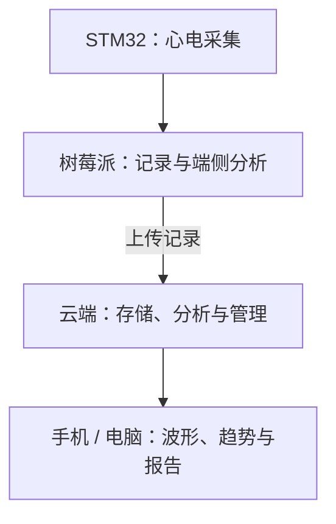

# 心电采集与分析系统

**STM32 采集 · 树莓派终端 · 云端平台 · 心电健康助手**

面向生物医学工程课程的完整心电项目：在终端测量、保存并上传记录，在手机和电脑查看波形、趋势与分析报告，由管理员统一管理账号和采集设备。

[下载应用](#应用下载) · [快速使用](#快速使用) · [项目文档](docs/README.md) · [更新日志](CHANGELOG.md)

## 应用下载

- **Android 8.0+**：[下载心电健康助手 1.1.0 APK](https://github.com/XiongBoT/bme-ecg-system/releases/download/android-v1.1.0-preview.1/ecg-records-1.1.0.apk) · [版本说明与校验](https://github.com/XiongBoT/bme-ecg-system/releases/tag/android-v1.1.0-preview.1)
- **Windows 10/11**：[下载心电工作台 1.2.0 ZIP](https://github.com/XiongBoT/bme-ecg-system/releases/download/desktop-v1.2.0/ecg-workspace-windows-1.2.0.zip) · [版本说明与校验](https://github.com/XiongBoT/bme-ecg-system/releases/tag/desktop-v1.2.0)
- **浏览器 / iPhone**：[打开云端工作台](https://62.234.150.104/)；iPhone 可添加到主屏幕。

Windows 完整解压后运行“心电工作台.exe”，无需安装 Python 或 Node.js。安装步骤见 [Windows 说明](心电云端平台/deploy/desktop/使用说明.txt)和[手机安装指南](docs/手机端与安卓安装包.md)。

> **版本说明：** Android 1.1.0 和 Windows 1.2.0 为公开试用版。账号申请、趋势和手机发起测量等功能需要云端与终端配套升级，安装新版应用不等于服务器已更新。部署及实机验收情况以[版本与交付状态](docs/版本与交付状态.md)为准。

当前安装包构建自 `87f23ba`，不包含随后合入的片段标注、自动备份和导航调整。旧版 Android 应用需手动安装新版，刷新页面不会更新内置界面。

## 快速使用

1. **登录账号。** 打开网页或应用，用本人平台账号登录。已启用新版申请功能时，可提交账号申请并等待审核；没有入口或忘记密码时联系项目管理员。
2. **完成测量。** 管理员先为账号授权设备，再在树莓派终端选择本人账号，采集、保存并上传。配套升级完成后，也可从手机发起 1 / 3 / 5 分钟测量。
3. **查看报告。** 在手机或电脑刷新记录，核对采集和上传状态，查看波形及分析；需要完整原始数据时导出 CSV，需要展示结果时使用报告预览与打印。

手机负责发起请求和查看结果，实际采集由 STM32 与树莓派完成。**账号申请通过后，仍需管理员分配设备权限。**

详细操作：[快速开始](心电云端平台/docs/快速开始.md#使用现有平台) · [手机使用说明](心电云端平台/docs/使用说明.md#手机使用流程) · [终端日常使用](树莓派心电终端/docs/设备待机与日常使用.md)

## 主要功能

以下为当前主分支已实现的能力，实际可用范围取决于各端安装和部署版本。

- **采集与记录：** 实时波形、信号质量提示、固定时长测量、本地保存及联网上传。
- **分析与回看：** 心搏分类、独立 QRS / RR 分析、日月年趋势，以及 CSV 和报告导出。
- **多端访问：** 多台终端独立接入，手机、电脑共享云端记录，个人数据按账号隔离。
- **平台管理：** 账号申请审核、设备授权、任务中心、人工复核、记录整理和服务器备份。

健康助手的具体功能见[应用说明](docs/心电健康助手.md)；算法适用范围、评测结果和 HRV 条件见[算法与评估](docs/算法与评估.md)。

<details>
<summary>查看系统数据流</summary>



完整模块关系、测量请求及权限边界见[系统架构与数据流](docs/系统架构.md)。

</details>

## 从这里开始

按你的任务选择一份主要指南；全部资料见[文档中心](docs/README.md)。

| 你的任务 | 主要入口 |
| --- | --- |
| 使用手机、电脑或测量终端 | [健康助手指南](docs/心电健康助手.md) · [终端操作](树莓派心电终端/docs/设备待机与日常使用.md) |
| 管理账号、设备和记录 | [管理员指南](docs/管理员指南.md) |
| 开发硬件、终端或云端 | [系统架构](docs/系统架构.md) · [仓库导览](docs/仓库导览.md) · [接口约定](docs/接口约定.md) |
| 部署、升级或回退 | [部署与升级](心电云端平台/docs/部署与升级.md) · [交付状态](docs/版本与交付状态.md) |
| 研究算法或参与课程项目 | [算法与评估](docs/算法与评估.md) · [项目计划书](docs/项目计划书.md) · [贡献指南](CONTRIBUTING.md) |

<details>
<summary>展开仓库目录与模块入口</summary>

| 目录 | 内容 |
| --- | --- |
| [硬件 / STM32 心电采集](硬件/STM32心电采集/README.md) | 固件、HAL/CMSIS、Keil 工程及接线资料 |
| [树莓派心电终端](树莓派心电终端/README.md) | 串口接收、屏幕显示、记录、端侧分析与上传 |
| [心电云端平台](心电云端平台/README.md) | 服务端、网页、账号设备管理、客户端与部署工具 |
| [docs](docs/README.md) | 共同接口、系统指南、项目计划与公开数据评测 |
| [tools](tools/README.md) | 仓库级检查工具 |

各模块 README 提供入口，现行说明在模块 `docs/`，历史资料在 `docs/archive/`，测试在 `tests/`。离线 `README.txt` 从现行 Markdown 自动生成。

真实心电记录、账号数据库、凭据、运行环境和历史工作副本不纳入 Git；克隆仓库不会获得这些内容。资料归位与共享规则见[贡献指南](CONTRIBUTING.md#文件与数据)。

</details>

## 开发环境

桌面开发使用 Python 3.12、Node.js 22 与 Git；STM32 使用 Keil。普通使用者直接下载应用即可。

<details>
<summary>展开本地安装与检查命令</summary>

在 PowerShell 中，从仓库根目录执行：

```powershell
py -3.12 -m venv .venv
.\.venv\Scripts\python.exe -m pip install -r "树莓派心电终端/requirements-pi.txt" -r "心电云端平台/requirements-test.txt" -r "心电云端平台/requirements-model.txt"
.\.venv\Scripts\python.exe tools/run_checks.py
```

不需要激活虚拟环境。Node.js 用于网页脚本测试；Python Tk 测试需要可用的显示环境，跳过项应在 PR 中说明。两个 Python 工程分别运行检查，避免同名模块互相干扰。

树莓派 ARM32 按[终端说明](树莓派心电终端/README.md)安装，不复制 Windows 虚拟环境。STM32 工程使用 ARM Compiler 5.06 update 7（build 960）与 Keil.STM32F1xx_DFP 2.3.0，具体以工程配置为准；固件编译和板上联调单独验收。

</details>

开发协作从[贡献指南](CONTRIBUTING.md)开始；各模块的启动方式见对应 README。

## 版本与部署

- **查看进度：** [交付状态](docs/版本与交付状态.md)集中记录源码、公开下载、实际部署与待验收项；[更新日志](CHANGELOG.md)记录功能变化。
- **参与修改：** 所有成员均可修改所有模块。先在 Issue 声明范围，再使用独立分支和工作目录；PR 通过检查、同步 main 并解决讨论后，由 XiongBoT 审核当前提交并决定合并，不要求其他成员批准。
- **执行升级：** 合并源码不自动部署。更新服务器或设备前，记录版本、备份与回退方式，按[部署与升级](心电云端平台/docs/部署与升级.md)执行。

完整协作与发布规则见[协作质量与发布](docs/协作质量与发布.md)。

## 项目用途与许可

本项目用于课程学习与研究，软件测试和公开数据库评测不代表临床有效性验证。模型、第三方库和公开验证数据遵循各自许可证，保留原 LICENSE 与来源说明；仓库尚未为整个项目额外授予开源许可证。
