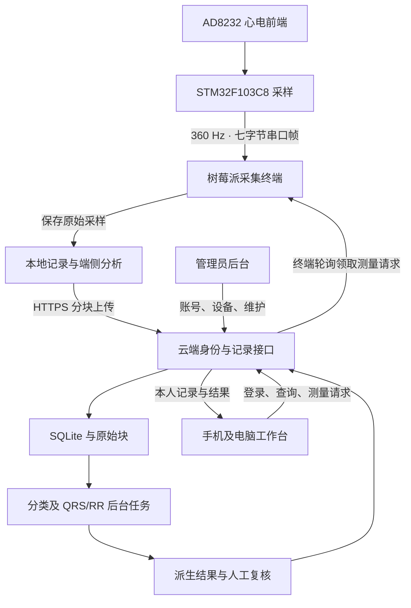
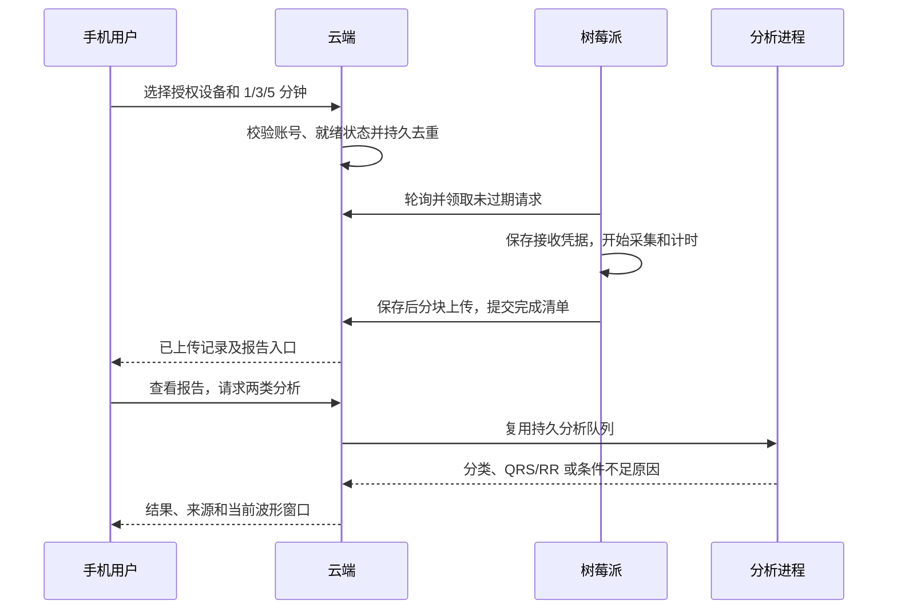

# 系统架构与数据流

[项目首页](../README.md) · [文档中心](README.md) · [源码地图](仓库导览.md) · [接口约定](接口约定.md)

本文对应 2026-11-25 主分支 `b656a64`：统一管理后台、工作流和心电健康助手均已合并。它描述源码结构；公开下载、服务器版本和实物验证分别见[版本与交付状态](版本与交付状态.md)。

## 系统框图

手机负责发起请求和查看结果；实际采样、计时、落盘由 STM32 与树莓派完成。设备联网后上传已经保存的记录；断网时本地记录保留，重连后按上传结果补传。网页关闭不取消已经接受的采集或分析。

## 各模块职责

| 模块 | 当前职责 | 主要入口 |
| --- | --- | --- |
| STM32 | ADC 采样、来源/无效标记、序号及校验 | [固件](../硬件/STM32心电采集/README.md) |
| 树莓派 | 串口接收、波形与质量提示、端侧 N/S/V、记录、定时测量及上传 | [终端](../树莓派心电终端/README.md) |
| 云端 | 身份、记录归属、设备授权、上传校验、持久分析与维护任务 | [云端](../心电云端平台/README.md) |
| 浏览器/PWA | 从服务器取得网页，查看本人记录、趋势、任务、报告与设置 | [使用说明](../心电云端平台/docs/使用说明.md) |
| Android | Java 容器和随 APK 安装的网页；密码安全保存、CSV 保存及系统打印 | [安卓工程](../心电云端平台/android/README.md) |
| Windows | 打开固定 HTTPS 工作台；启动器版本与服务器网页分开更新 | [桌面入口](../心电云端平台/deploy/desktop/README.md) |
| 管理后台 | 审核申请、账号生命周期、设备授权、记录元信息、检查与备份 | [管理员指南](管理员指南.md) |
| 离线研究 | 公开数据 QRS/分类评测、结果与复跑证据 | [算法与评估](算法与评估.md) |

## 一次固定时长测量

“固定时间”在当前实现中指固定时长，不是每天某个钟点自动测量。45 秒未领取的请求过期，同一设备只允许一项活动测量；终端重启不重复执行旧请求。提前停止使用终端按钮。报告中的采样时长按实际保存点数计算，不能用所选时长代替。

上传后自动分析是另一项账号偏好，默认关闭，只作用于此后首次上传完成的记录。手动分析和自动分析复用已有队列；分析失败不撤销原始上传。

## 记录、结果与权限

| 内容 | 保存及解释 |
| --- | --- |
| 原始记录 | 树莓派本地保存，云端以 ECGRAW01 块和 SQLite 索引管理；派生分析不覆盖原始 ADC |
| 终端统计 | 采集时生成的质量、心率和分类摘要；历史趋势心率取终端合格窗口，不取云端 QRS 结果 |
| 云端结果 | 心搏分类与 QRS/RR 分别运行、分别带输入摘要和算法版本；缺失或条件不足不能当作正常 |
| 人工复核 | 待复核、已查看、疑似干扰及备注；结果重跑或上下文变化会过期，不修改模型标签 |
| 导出 | CSV 用于原始数据；网页报告仅包含当前读取的结果和波形窗口；服务器备份保护数据库和引用的原始块 |
| 身份 | 浏览器使用账号会话 Cookie，写操作校验 CSRF；终端使用独立设备凭据，服务端核对授权与归属 |

普通账号只读自己的记录；管理员可管理元信息，但不会因此获得他人波形或模型结果。账号申请通过不自动授予设备权限。设备凭据、平台密码和 GitHub/SSH 账号属于不同用途。

## 当前边界

- 心电健康助手的服务器、终端和 APK 需配套升级；旧 APK 不会通过刷新替换内置网页。
- 目前没有手机直接通过蓝牙采集的实现；无线方案仍在[项目计划](项目计划书.md)中。
- 片段标注、自动备份计划和跨客户端版本提醒仍由独立任务推进，不能按现有主分支功能验收。
- 模型 N 类不能代替可信 NN；没有可信 NN 时 HRV 不可用。离线研究与软件测试不能替代实采和临床验证。
