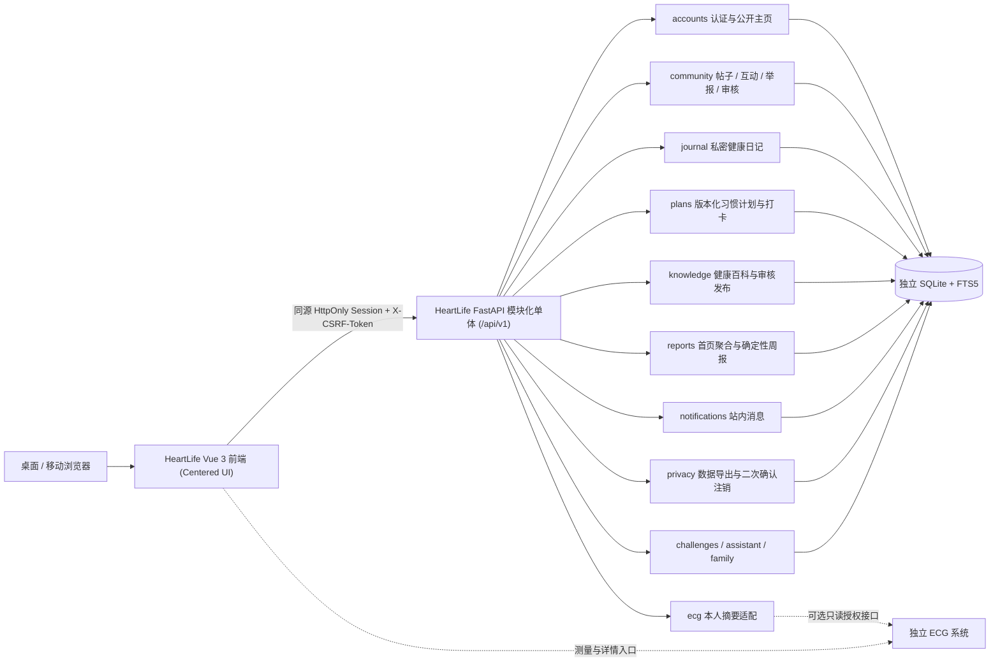

# HeartLife 系统架构说明 (Architecture)

## 1. 架构定位与服务边界

**心伴（HeartLife）** 是独立的心脏健康生活记录、习惯计划、健康科普与同伴互助 Web 平台。

- **独立服务**：代码位于 `heartlife/`，不导入原心电平台业务模块，不连接其 SQLite 数据库，不共享会话 Cookie。跨模块接口变更遵循根目录协作与测试约定。
- **可选授权集成**：按用户确认的方案增加 `ecg` 适配模块，通过一次性绑定码和可撤销的 `summary:read` 授权读取本人摘要。接口凭据只用于服务端；测量和波形详情继续进入原平台。配置为空时仅保留合法 HTTPS 外链。细节见[心电集成](心电集成.md)。

## 2. 核心设计要点

1. **认证与权限最小化**：
   - 密码使用 Argon2id 哈希存储；会话令牌使用 256-bit 随机值并在服务端保存 SHA-256 摘要。
   - 写操作强制校验会话绑定的 `X-CSRF-Token`；登录接口按 `(IP, 账号)` 结合可注入时钟执行滑动窗口限流。
   - 角色划分为 `member`、`moderator`（社区举报与内容可见性处理）、`editor`（健康百科编审与发布）。`moderator` 与 `editor` 在后端服务层同样无权读取任何用户的私密日记、计划或周报。
2. **时区感知与确定性统计**：
   - 时间戳统一以 UTC 存储，日常记录与打卡使用基于用户时区计算的本地 ISO 日期 `local_date`。
   - 习惯计划采用 `plans` + `plan_versions` 版本链记录生效区间 `[effective_from, effective_to]`，修改星期或归档自下一本地日生效，不篡改历史应执行分母。
   - 健康周报实时聚合计算，严格区分 `null`（未记录）与真实 `0` 值，应执行计划数为 `0` 时返回 `null`（界面显示「无计划」）。
3. **可关闭的本地检索生活助手（P1）**：
   - 默认 `ASSISTANT_ENABLED=false`。启用时通过 SQLite FTS5 仅检索已发布且经审核的百科条目，个人周报/计划工具须经当次请求显式勾选授权且仅传递脱敏汇总数值，输出经引用 ID 与数值一致性校验，急症与诊疗诉求直接触发保守就医引导。
