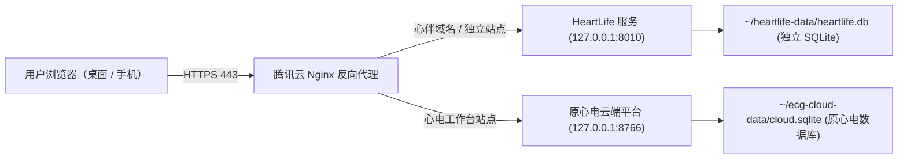

# 腾讯云部署与运维指南（HeartLife 心伴平台）

本文档说明如何将 **HeartLife（心伴）健康生活与同伴社区平台** 部署到腾讯云 Ubuntu 24.04 云主机（CVM / 轻量应用服务器），并与现有的 **心电云端平台**（`127.0.0.1:8766`）保持**进程、数据库、端口与代码完全解耦**，互不干扰。

---

## 1. 架构与隔离设计



- **零侵入并行运行**：
  - 原心电云端平台保持运行在 `127.0.0.1:8766`（`ecg-cloud.service` + `~/ecg-cloud-data`）。
  - HeartLife 独立运行在 `127.0.0.1:8010`（`heartlife.service` + `~/heartlife-data`），使用单进程 Uvicorn（避免 SQLite 多进程写锁竞争）。
  - 腾讯云安全组**仅需开放 `80` / `443`（及管理员 SSH）**，严禁对公网放行 `8010` 或 `8766` 端口。
- **跨系统安全跳转**：通过环境变量 `ECG_EXTERNAL_URL=https://62.234.150.104/`（或正式心电域名），HeartLife 首页会自动渲染「独立心电检测」入口并在弹窗确认后以无参数静态 HTTPS 链接打开原心电工作台，不附带任何会话 Token。

---

## 2. 服务器环境要求

- **操作系统**：腾讯云 Ubuntu 24.04 LTS（2 核 2GB ~ 2 核 4GB 即可流畅运行）
- **基础依赖**（首次在云主机执行一次）：

```bash
sudo apt-get update
sudo apt-get install -y python3 python3-venv python3-pip nginx certbot python3-certbot-nginx curl unzip
# 若尚未安装 Node.js 22（用于构建前端静态包 frontend/dist）：
curl -fsSL https://deb.nodesource.com/setup_22.x | sudo -E bash -
sudo apt-get install -y nodejs
```

---

## 3. 首次部署步骤

### 第一步：上传源码到云主机普通用户目录

不要在 `root` 下运行业务进程。在普通登录用户（例如 `ubuntu`）下获取本仓库分支或上传 `heartlife` 目录至 `~/heartlife`：

```bash
git clone https://github.com/XiongBoT/bme-ecg-system.git ~/bme-ecg-system
ln -s ~/bme-ecg-system/heartlife ~/heartlife
```

### 第二步：执行一键安装脚本

```bash
bash ~/heartlife/deploy/tencent-cloud/install.sh
```

该脚本会自动完成：
1. 创建与代码分离的数据目录 `~/heartlife-data`（权限 `700`）并生成带随机强密钥的 `~/heartlife-data/heartlife.env`（默认 `APP_ENV=production`、`DEMO_MODE=false`、`COOKIE_SECURE=true`）。
2. 创建 `~/heartlife/.venv` 并安装 `backend/requirements.txt`。
3. 在 `frontend/` 执行 `npm ci && npm run build` 生成生产包 `frontend/dist`（由 FastAPI 直接托管 SPA 静态资源与回退路由）。
4. 对 `~/heartlife-data/heartlife.db` 执行 Alembic 数据库迁移。
5. 写入用户级服务 `~/.config/systemd/user/heartlife.service`。

### 第三步：核对环境变量并启动后台服务

编辑 `~/heartlife-data/heartlife.env`，将 `FRONTEND_ORIGIN` 修改为实际对外访问的 HTTPS 源（例如 `https://heartlife.yourdomain.com` 或实际公网 HTTPS 地址）：

```bash
nano ~/heartlife-data/heartlife.env
```

如课程演示阶段需要在云端展示预置合成演示帖子、百科与体验账号，可临时在 `heartlife.env` 中设置 `DEMO_MODE=true` 后执行一次：

```bash
cd ~/heartlife
set -a && source ~/heartlife-data/heartlife.env && set +a
./.venv/bin/python scripts/populate_rich_demo.py
```

> **注意**：正式面向真实用户运行时，请保持 `DEMO_MODE=false`，不创建任何固定弱口令演示账号。

启动服务并开启退出 SSH 后常驻（linger）：

```bash
systemctl --user daemon-reload
systemctl --user enable --now heartlife.service
sudo loginctl enable-linger "$(id -un)"

# 本机健康检查
curl --fail http://127.0.0.1:8010/api/v1/health
ss -ltn | grep 8010
```

确认输出包含 `"status":"ok"` 且仅监听 `127.0.0.1:8010`。

### 第四步：配置 Nginx HTTPS 反向代理

1. 参考 [deploy/tencent-cloud/nginx-heartlife.conf](../deploy/tencent-cloud/nginx-heartlife.conf)，复制到 `/etc/nginx/sites-available/heartlife.conf` 并替换域名与证书路径：
   - **有独立域名/子域名**（推荐，如 `heartlife.example.com`）：使用 `sudo certbot --nginx -d heartlife.example.com` 自动签发并续期证书。
   - **纯公网 IPv4 无域名**：可沿用原心电云端平台已验证的 Let's Encrypt 短期 IP 证书方案，或为 HeartLife 分配独立 HTTPS 端口（如 `8443 ssl`）并在腾讯云安全组放行该 HTTPS 端口（同时将 `FRONTEND_ORIGIN` 设为 `https://<公网IP>:8443`）。
2. 校验并重载 Nginx（不会中断原心电云端服务）：

```bash
sudo ln -sf /etc/nginx/sites-available/heartlife.conf /etc/nginx/sites-enabled/heartlife.conf
sudo nginx -t
sudo systemctl reload nginx
```

---

## 4. 日常运维、备份与安全回退

### 查看日志与运行状态

```bash
systemctl --user status heartlife.service --no-pager
journalctl --user -u heartlife.service -n 100 --no-pager
```

### 数据备份（升级前必做）

数据目录 `~/heartlife-data` 独立于代码目录。升级前请先停止 `heartlife.service` 后备份一致的 SQLite 数据库副本：

```bash
systemctl --user stop heartlife.service
cp -a ~/heartlife-data "~/heartlife-data-backup-$(date +%Y%m%d-%H%M%S)"
systemctl --user start heartlife.service
```

### 平滑升级步骤

```bash
cd ~/bme-ecg-system
git pull --ff-only
bash ~/heartlife/deploy/tencent-cloud/install.sh
systemctl --user restart heartlife.service
curl --fail http://127.0.0.1:8010/api/v1/health
```

### 快速回退

若升级后检查异常：
1. `systemctl --user stop heartlife.service`
2. 在源码目录切换回上一稳定提交并重新执行 `npm run build`
3. 如涉及数据库迁移回退，将升级前备份的 `~/heartlife-data-backup-*` 恢复到新目录核验无误后切换，再启动服务。
